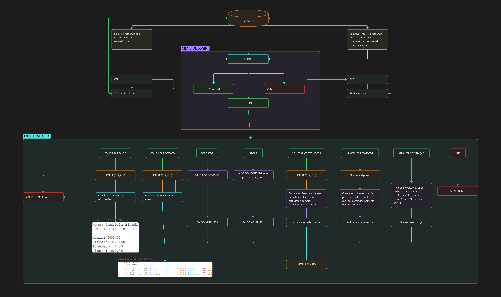

# Exchange de Criptomoedas

Sistema de exchange de criptomoedas para terminal, feito em C como projeto da faculdade (Ciência da Computação, FEI). O usuário se cadastra, faz login, deposita, saca, compra e vende Bitcoin, Ethereum e Ripple, e consulta saldo e extrato. Os dados ficam em arquivos de texto.

## Fluxograma



## Funcionalidades

**Menu de login**

| Opção | O que faz |
|-------|-----------|
| 1 - Login | Pede CPF e senha e libera o menu do usuário |
| 2 - Cadastro | Pede CPF, senha numérica de 6 dígitos e nome, e cria o `dados.txt` |
| 3 - Sair | Encerra o programa |

**Menu do usuário**

| Opção | O que faz | Pede senha? |
|-------|-----------|:-----------:|
| 1 - Consultar saldo | Mostra nome, CPF, saldo em reais e em cada criptomoeda | sim |
| 2 - Consultar extrato | Mostra o histórico de operações | sim |
| 3 - Depositar | Soma o valor ao saldo em reais | não |
| 4 - Sacar | Subtrai do saldo em reais (não deixa ficar negativo) | não |
| 5 - Comprar criptomoeda | Compra Bitcoin, Ethereum ou Ripple | sim |
| 6 - Vender criptomoeda | Vende Bitcoin, Ethereum ou Ripple | sim |
| 7 - Atualizar cotação | Gera novas cotações aleatórias | não |
| 8 - Sair | Sai da conta | não |

## Regras de compra e venda

- A senha numérica de 6 dígitos é pedida antes de comprar ou vender.
- O programa mostra as cotações atuais e o usuário escolhe a moeda e **quanto quer negociar em reais**.
- O saldo em reais e o saldo de cada criptomoeda nunca ficam negativos. Se não houver saldo, a operação é recusada e nada muda.
- **Compra:** a taxa é cobrada por cima do valor. Comprar R$ 100,00 de Ripple debita R$ 101,00 (R$ 100,00 + 1%) e credita R$ 100,00 / cotação em Ripple.
- **Venda:** a taxa é descontada do que entra. Vender R$ 100,00 de Bitcoin credita R$ 97,00 (R$ 100,00 - 3%) e debita R$ 100,00 / cotação em Bitcoin.

| Criptomoeda | Taxa de compra | Taxa de venda | Cotação inicial |
|-------------|:--------------:|:-------------:|----------------:|
| Bitcoin     | 2%             | 3%            | R$ 300.000,00   |
| Ethereum    | 1%             | 2%            | R$ 15.000,00    |
| Ripple      | 1%             | 1%            | R$ 3,50         |

**Atualizar cotação:** cada moeda recebe uma variação aleatória e independente entre -5% e +5% sobre o valor anterior.

## Estrutura do projeto

```
exchange-de-criptomoedas/
├── README.md
├── .gitignore
├── docs/
│   └── fluxograma.png
├── src/
│   ├── main.c               # menu de login (login e cadastro)
│   ├── menu_investidor.c    # menu do usuário (saldo, extrato, depósito, saque, compra, venda, cotação)
│   ├── menu_investidor.h
│   ├── carregar_dados.c     # lê o dados.txt para a struct
│   ├── carregar_dados.h
│   └── investidor.h         # struct investidor
└── output/                  # gerado ao compilar e rodar (fora do git)
    ├── main.exe
    ├── dados.txt
    └── extrato.txt
```

## Como compilar e executar

Precisa de um compilador C (`gcc`, por exemplo MinGW no Windows). Na pasta do projeto:

```bash
mkdir output
gcc src/main.c src/menu_investidor.c src/carregar_dados.c -o output/main.exe
cd output
./main.exe
```

O programa lê e grava `dados.txt` e `extrato.txt` na pasta em que é executado, então rode sempre de dentro de `output/` para não espalhar esses arquivos.

## Arquivos de dados

**`dados.txt`** guarda um usuário, um dado por linha:

```
CPF
senha
nome
saldo em reais
saldo em Bitcoin
saldo em Ethereum
saldo em Ripple
```

**`extrato.txt`** recebe uma linha por operação:

```
09-11-2026 17:48 + 1.00 XRP CT: 3.50 TX: 0.01 REAL: 998.99 BTC: 0.000 ETH: 0.0000 XRP: 0.29
```

| Campo | Significado |
|-------|-------------|
| `09-11-2026 17:48` | Data e hora |
| `+` / `-` | `+` entrada (depósito ou compra), `-` saída (saque ou venda) |
| `1.00 XRP` | Valor da operação **em reais** e a moeda negociada (`REAL` para depósito e saque) |
| `CT` | Cotação usada na operação |
| `TX` | Taxa aplicada, em fração (`0.01` = 1%) |
| `REAL`, `BTC`, `ETH`, `XRP` | Saldos depois da operação |

## Limitações conhecidas

- Só existe **um usuário** por vez: o cadastro cria o `dados.txt` e, se ele já existir, avisa que o cadastro já foi feito.
- A senha fica guardada em texto puro no `dados.txt`. É um projeto didático, não use senhas reais.
- As cotações são simuladas, não vêm de nenhuma fonte real.

## Autor

Lucas Felix, Ciência da Computação, Centro Universitário FEI.